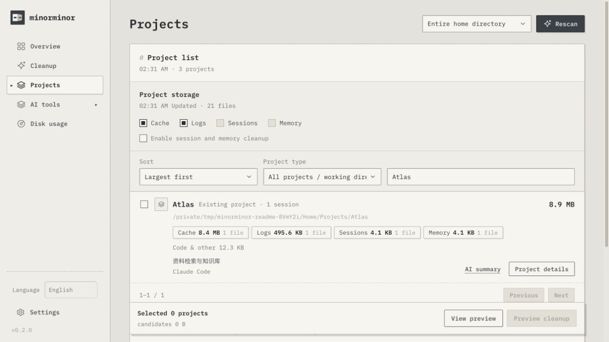

<p align="center"></p>
<h1 align="center">Minorminor</h1>
<p align="center"><strong>See what takes space. Choose what goes.</strong><br />Inspect files, projects and AI tools on your Mac. Review a preview before cleanup.</p>

<p align="center">
  <a href="package.json"></a>
  <a href="docs/desktop.en.md#requirements"></a>
  <a href="native/Cargo.toml"></a>
  <a href="#license"></a>
  <a href="https://github.com/tw93/Mole/blob/6650d0958282aa8052cd2bfeee15f67b17fe613b/LICENSE"></a>
</p>
<p align="center"><a href="README.md">简体中文</a> · <strong>English</strong></p>
<p align="center"><a href="#get-started">Get started</a> · <a href="docs/desktop.en.md">Desktop guide</a> · <a href="#development">Development</a></p>


<p align="center"><sub>Actual Web interface with isolated sample projects. The desktop app shares its visual style.</sub></p>

## What it does

| Feature | What you can inspect and control |
| --- | --- |
| **One scan** | Background traversal updates file categories, folder sizes, project storage and tool discovery. |
| **Browse deeper** | Expand folders and files; distinguish caches, logs, sessions, memory and retained data. |
| **Clean by project** | Select a scope, review individual files, confirm, then inspect file destinations. |
| **Optional AI** | Analyze metadata or summarize a file or folder you explicitly select. |

## Get started

Source builds require **macOS 12+, Git, Rust 1.88+ and Xcode Command Line Tools**. No global Mole installation is needed.

```sh
git clone --recurse-submodules https://github.com/Ray-hola/Minorminor.git
cd Minorminor
./scripts/run-native.sh
```

You can also double-click **`start.command`**. The first launch compiles the Rust app, then opens a standalone window. Choose **简体中文 / English** in the sidebar; your choice is saved.

**Scan → browse → select → preview and confirm.** Navigation does not interrupt background scanning.

This is the **v0.2.0 development preview**; no Release installer is available. See the [desktop guide](docs/desktop.en.md) to build a local `.app`. The built app needs neither Node.js nor Rust at runtime. It is ad-hoc signed, without Apple Developer ID signing or notarization.

<details>
<summary>Use the browser version</summary>

Requires Node.js 22+; no npm dependencies are needed:

```sh
npm run web
```

Open <http://127.0.0.1:4783>. If the port is busy, use `PORT=4784 npm run web`. The [full Web guide (Chinese)](docs/usage.md) covers the original browser workflow. The two engines store scan history separately.

</details>

## Cleanup and AI

- **Preview, then confirm.** Desktop cleanup moves reviewed files to Trash and records each destination; advanced Mole commands are preview-only. The browser version also has permanent visual cleanup and full Mole cleanup, with the scope stated before confirmation.
- **AI analysis cannot read document content.** It uses metadata and structural evidence. AI summaries read a bounded sample only after you select the resource and confirm sending it to your configured model.
- **A model is optional.** Local Ollama and compatible APIs are supported. Scanning and cleanup work independently. Uncertain and unreadable items are marked.

Services bind only to loopback. Desktop records are stored in `~/Library/Application Support/com.minorminor.desktop/`; browser records live in the project's `.runtime/`. API keys stay in process memory. File names, paths, content and raw command output retain their original language.

## Development

| Location | Responsibility |
| --- | --- |
| [`native/`](native/) | Rust scanner, index, cleanup and macOS window |
| [`public/`](public/) | Shared styles, desktop/Web interfaces and language catalog |
| [`lib/`](lib/) · [`server.mjs`](server.mjs) | Browser engine and local service |
| [`vendor/mole/`](https://github.com/tw93/Mole/tree/6650d0958282aa8052cd2bfeee15f67b17fe613b) | Mole submodule at a pinned commit |

```sh
npm run check
npm test
cargo test --locked --manifest-path native/Cargo.toml --no-default-features
./scripts/build-macos.sh
```

Web checks require Node.js 22+. Rust tests use temporary fixtures. Build artifacts are excluded from Git. Report problems through [Issues](https://github.com/Ray-hola/Minorminor/issues).

## License

Mole is included unchanged as a pinned submodule. See [UPSTREAM.json](UPSTREAM.json) and its [GPL-3.0 license](https://github.com/tw93/Mole/blob/6650d0958282aa8052cd2bfeee15f67b17fe613b/LICENSE). Minorminor is not affiliated with the official Mole app.

**No separate license has been selected for the new Minorminor code.** Public source does not imply a license to reuse it. Bundled IBM Plex fonts retain the [SIL Open Font License 1.1](public/fonts/OFL.txt). Badges describe the actual license status and source version; they do not imply a formal release or Apple certification.
