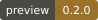
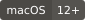
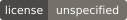
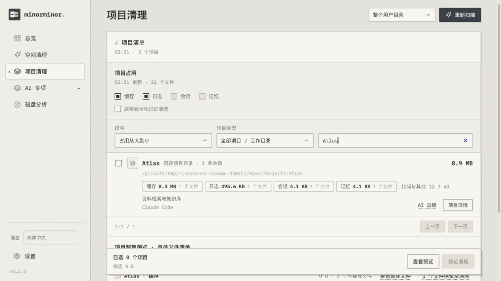

<p align="center"></p>
<h1 align="center">Minorminor</h1>
<p align="center"><strong>看清占用，再决定清理。</strong><br />在 Mac 上查看文件、项目与 AI 工具占用，预览并确认后再处理。</p>

<p align="center">
  <a href="package.json"></a>
  <a href="#开始使用"></a>
  <a href="package.json"></a>
  <a href="LICENSE"></a>
  <a href="https://github.com/tw93/Mole/blob/6650d0958282aa8052cd2bfeee15f67b17fe613b/LICENSE"></a>
</p>
<p align="center"><strong>简体中文</strong> · <a href="README.en.md">English</a> · <a href="https://github.com/Ray-hola/Minorminor-Rust">Rust Application 版</a></p>
<p align="center">集成 <a href="https://github.com/tw93/Mole">Mole</a> 子模块 · 感谢 <a href="https://github.com/tw93">Tw93</a> 与贡献者</p>
<p align="center"><a href="#开始使用">开始使用</a> · <a href="docs/usage.md">完整说明</a> · <a href="#开发">开发</a></p>


<p align="center"><sub>实际界面，使用独立的示例项目与文件。</sub></p>

## 可以做什么

| 功能 | 你能看到与操作的内容 |
| --- | --- |
| **一次扫描** | 后台遍历，同步更新文件分类、文件夹大小、项目占用和工具识别。 |
| **逐层查看** | 展开目录与文件，区分缓存、日志、会话、记忆与保留内容。 |
| **按项目整理** | 勾选范围，审阅具体文件，确认处理，查看逐文件结果。 |
| **可选 AI** | 根据元数据辅助判读，为你点选的文件或文件夹生成总结。 |

**版本说明：** 本仓库独立维护 **Minorminor Web 版（Node.js 后端）**；[**Rust Application 版**](https://github.com/Ray-hola/Minorminor-Rust)在独立仓库维护，两个版本分别管理启动入口、接口、记录与版本。

## 开始使用

需要 **macOS、Git 和 Node.js 22+**。无需安装 npm 依赖，也无需全局安装 Mole。

```sh
git clone --recurse-submodules https://github.com/Ray-hola/Minorminor.git
cd Minorminor
npm start
```

打开 **<http://127.0.0.1:4783>**，或双击项目里的 **`start.command`** 启动。终端中按 `Ctrl+C` 停止服务。

侧栏「语言」可切换 **简体中文 / English**，选择保存在当前浏览器中。文件名、路径、正文和原始命令输出保留原文。

**扫描 → 展开查看 → 勾选范围 → 预览并确认。** 刷新或切换页面不会中断后台扫描。当前为 **v0.1.0 开发预览**，尚未提供 Release 安装包。

<details>
<summary>端口占用，或 Mole 子模块为空？</summary>

端口占用时运行 `PORT=4784 npm start`，打开 <http://127.0.0.1:4784>。

如果克隆时遗漏子模块，在项目目录运行：

```sh
git submodule update --init --recursive
```

</details>

## 清理与 AI

- **先预览，再确认。** 可视化清理会永久删除所选缓存和日志；项目清理移到废纸篓；高级 Mole 整次清理可能包含废纸篓。各入口会说明范围和影响。
- **AI 分析不读文档正文。** 仅使用元数据与结构特征；「AI 总结」在你点选范围并确认后，才抽读内容并发送至所配置的模型。文件夹总结会标明抽读范围。
- **模型连接可选。** 支持本机 Ollama 与兼容接口；扫描和整理可独立使用。工具识别可能不完整，不确定或无法读取的内容会标明。

服务仅监听本机。扫描记录和连接配置保存在被 Git 忽略的 `.runtime/`；API Key 只保存在当前服务内存中。更多范围与恢复说明见 [完整说明](docs/usage.md)。

## 开发

界面与中英文文案在 [`public/`](public/)，扫描和清理逻辑在 [`lib/`](lib/)，服务入口为 [`server.mjs`](server.mjs)。

```sh
npm run check
npm test
```

测试使用临时样例。目录职责见 [开发说明](docs/usage.md#修改与验证)；反馈可提交至 [Issues](https://github.com/Ray-hola/Minorminor/issues)。

## 上游与许可

Minorminor 采用 [GNU GPL-3.0](LICENSE)（`GPL-3.0-only`）。内置 IBM Plex 字体保留 [SIL Open Font License 1.1](public/fonts/OFL.txt)。

本项目将 **Mole 作为 Git 子模块**引入 [`vendor/mole/`](https://github.com/tw93/Mole/tree/6650d0958282aa8052cd2bfeee15f67b17fe613b)，提供部分磁盘清理能力。

- **Mole 项目网址：[https://github.com/tw93/Mole](https://github.com/tw93/Mole)**
- 固定版本与来源：[UPSTREAM.json](UPSTREAM.json)；上游代码保持原样，保留其 [GPL-3.0 许可证](https://github.com/tw93/Mole/blob/6650d0958282aa8052cd2bfeee15f67b17fe613b/LICENSE)与版权声明。

感谢作者 **[Tw93](https://github.com/tw93)** 和 **[Mole 的所有贡献者](https://github.com/tw93/Mole/graphs/contributors)**，为本项目提供开源清理工具与实现参考。
